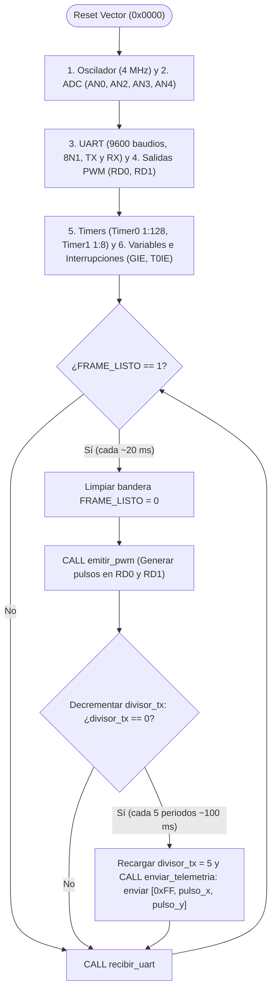
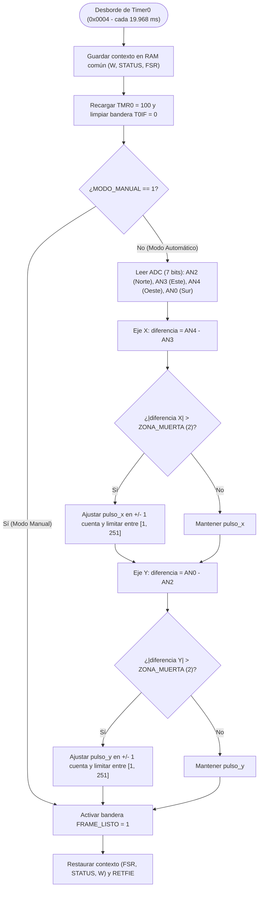
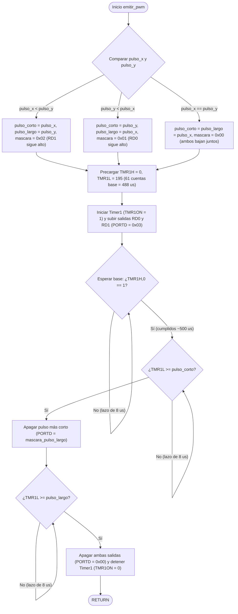
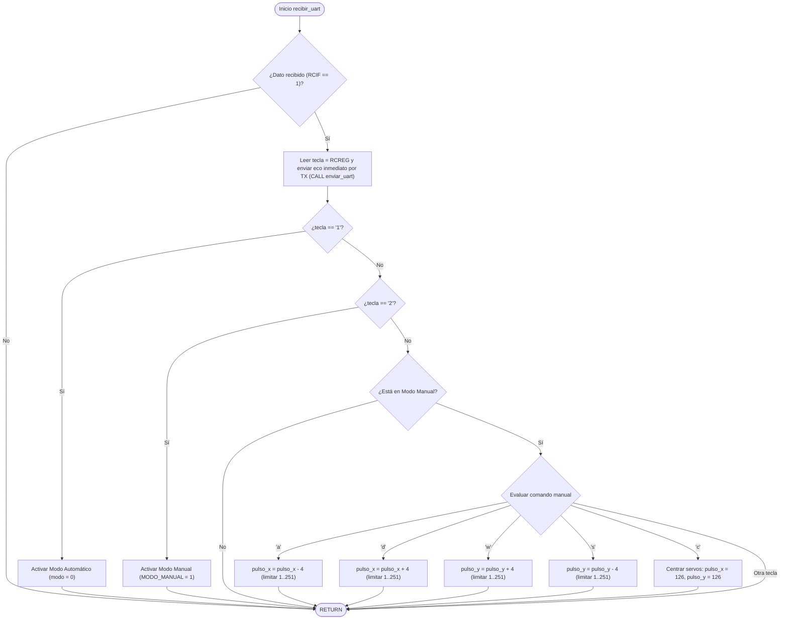

## Diagramas de Flujo del Firmware

### 1. Flujo General: Inicialización y Programa Principal (`inicio` y `principal`)

### 2. Rutina de Interrupción (`interrupcion` en `0x0004`) y Modo Automático (`ajustar_por_luz`)

### 3. Emisión de Pulsos PWM con Timer1 (`emitir_pwm`)

### 4. Recepción UART, Eco y Control Manual (`recibir_uart`)

---